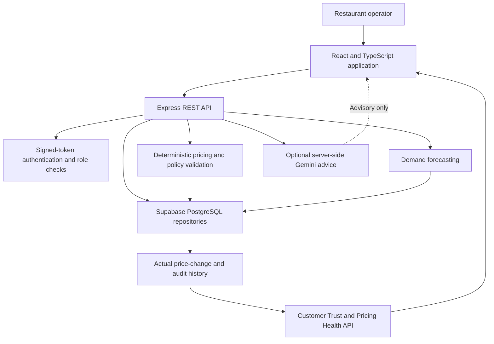

# RestaurantIQ

### Restaurant intelligence, explainable dynamic pricing, and customer-trust safeguards

[](#technology-stack) [](#architecture) [](#testing) [](#pricing-safeguards)

RestaurantIQ is a full-stack restaurant operations and revenue-management application. It brings menu economics, competitor observations, demand forecasting, pricing recommendations, approvals, and audit history into one workspace—while keeping pricing decisions deterministic and bounded by explicit business policies.

> **Customer trust is a pricing-stability objective, not a churn prediction.** The application does not have customer-linked visit history or complaint data. It therefore reports pricing-stability evidence and clearly describes data limitations rather than claiming that an individual customer will or will not return.

---

## Contents

- [Overview](#overview)
- [Highlights](#highlights)
- [Customer Trust & Pricing Health](#customer-trust--pricing-health)
- [Pricing Safeguards](#pricing-safeguards)
- [Architecture](#architecture)
- [Technology Stack](#technology-stack)
- [Application Areas](#application-areas)
- [API Reference](#api-reference)
- [Getting Started](#getting-started)
- [Environment Configuration](#environment-configuration)
- [Testing](#testing)
- [Data, Privacy & Limitations](#data-privacy--limitations)
- [Repository Layout](#repository-layout)
- [Production Notes](#production-notes)

## Overview

RestaurantIQ supports restaurant operators and revenue managers through a guided pricing workflow:

1. Review menu costs, sales history, inventory, and available competitor observations.
2. Generate explainable recommendations with demand and margin context.
3. Check economic floors, item ceilings, movement limits, protected-price settings, and actual applied-price history.
4. Review, approve, reject, or apply recommendations through authenticated backend routes.
5. Inspect persisted price changes and operator actions in the trust dashboard and audit trail.

The experience combines an immersive product entry page with an operational command center. Existing menu, forecasting, inventory, competitor, simulator, approval, settings, and audit features remain part of the same application.

## Highlights

- **Deterministic pricing engine:** Uses costs, contribution targets, demand, inventory, and available competitor benchmarks. AI-generated advice cannot authorize or apply a price.
- **Economic-floor enforcement:** Revalidates minimum contribution economics against current item costs and active outlet fees.
- **Price-stability guard:** Configurable increase and decrease caps, minimum days between changes, rolling cumulative increase limits, manager-review warnings, stable-price protections, and optional loyalty-price protection.
- **Actual-price history:** Only recorded manual price changes and successfully applied recommendations count as actual changes. Generated recommendations are not treated as history.
- **Approval and application checks:** Rechecks current price, floors, ceilings, and stability rules at approval and application. Stale or duplicate applications are rejected.
- **Override safeguards:** Admin manual overrides still need to pass economic-floor, ceiling, and movement policies.
- **Customer Trust dashboard:** Displays menu stability status, verified price history, movement totals, blocked recommendations, review items, available order trends, and data limitations.
- **Demand forecasting:** Holt-Winters time-series forecasting with held-out error metrics when enough observations are available, and an explicit insufficient-data path otherwise.
- **Competitor intelligence:** Stores observations and provenance, normalizes matched prices for portion size, and scopes competitor information by outlet location.
- **Governance and audit:** Captures approvals, applications, rejections, manual overrides, policy updates, and blocked recommendation events.
- **Authenticated roles:** Server-verified signed tokens govern administrator, revenue manager, kitchen operations, and auditor capabilities.
- **PostgreSQL persistence:** Stores operational state in Supabase PostgreSQL; JSON files remain local migration inputs and are not an application fallback.
- **Responsive premium interface:** React, Three.js, Tailwind CSS, charts, and motion-enhanced views preserve the established RestaurantIQ visual style.

## Customer Trust & Pricing Health

Open **Customer Trust** from the application sidebar or visit `/app/trust`.

The page presents backend-derived information for:

- Stable and protected menu items.
- Items approaching or exceeding configured price-movement limits.
- Recommendations that need additional review and recommendations blocked by policy.
- Actual price-change events, dates, actors, and price transitions.
- Rolling per-item price movement and last actual price-change date.
- Historical order-volume trends when sufficient daily observations exist.
- An item-level risk assessment with evidence, period examined, explanation, quality notes, and limitations.

### Interpreting the risk assessment

Risk is described as a **pricing-stability risk**. A high or medium rating describes recorded or proposed price movement relative to configured guardrails; it does not estimate a specific customer's likelihood to churn.

The current application does not persist customer identifiers, repeat-customer order sequences, or complaint records. Seeded demonstration order histories are synthetic and are explicitly identified as such. Missing customer or complaint data is shown as a limitation—not filled with invented metrics.

## Pricing Safeguards

The pricing engine and database workflows apply independent policy checks. High demand, competitor benchmarks, or a normal admin override do not supersede mandatory limits.

### Economic floor

For configured discounts and fees, the minimum gross price must cover variable cost and required contribution:

```text
net multiplier = (1 - discount rate) × (1 - total fee rate)
economic floor = ceil((variable cost + minimum contribution) / net multiplier)
effective floor = max(economic floor, item minimum policy price)
```

The final rounded proposal is checked against the effective floor, the item policy ceiling, and applicable price-movement rules. If the applicable bounds cannot all be satisfied, the proposal is explicitly blocked.

### Stability controls

Manager-configurable settings include:

| Setting | Purpose |
|---|---|
| Maximum increase per change | Caps a proposed upward movement from the current applied price. |
| Maximum decrease per change | Caps a proposed downward movement. |
| Minimum days between changes | Prevents repeated changes from actual price events inside the interval. |
| Rolling cumulative increase limit | Limits accumulated increases within a configurable rolling period. |
| Trust-risk review threshold | Flags large or limit-approaching proposals for manager attention. |
| Protected items and categories | Holds selected menu prices stable. |
| Loyalty-price protection | Optionally protects every item from price changes. |

Rolling checks use persisted price changes, not recommendation cycles. Historical change percentages are evaluated using the recorded transition sequence so repeated small changes cannot avoid the configured cap.

## Architecture



The Express server serves the Vite application in development and serves the built frontend in production mode. Pricing rules are implemented in the existing pricing engine and persistence/service layer rather than in a second pricing system.

## Technology Stack

| Area | Technologies |
|---|---|
| Frontend | React 19, TypeScript, Vite |
| Styling and interaction | Tailwind CSS 4, Lucide, GSAP, Motion |
| Immersive visuals | Three.js |
| Backend | Node.js, Express, TypeScript (`tsx`) |
| Persistence | Supabase PostgreSQL via the restricted Express runtime role |
| Authentication | HMAC-SHA256 signed session tokens and role-based access control |
| Forecasting | Deterministic Holt-Winters implementation with held-out validation |
| Optional AI advisory | Google Gemini via `@google/genai` |
| Tests | TypeScript release-gate suites run with `tsx` |

## Application Areas

| Area | What it covers |
|---|---|
| Command Center | Revenue and contribution indicators, alerts, and review queue. |
| Pricing & Margins | Explainable recommendations, warnings, approvals, and applications. |
| Menu Intelligence | Menu catalog, costs, item economics, and authorized price overrides. |
| Competitor Intelligence | Competitor observations, portion-aware matches, and imports. |
| What-If Prices | Scenario exploration for price, contribution, and demand assumptions. |
| Busy-Day Forecast | Menu-item demand projections and validation status. |
| Inventory & Food Cost | Stock levels, adjustments, and low-stock monitoring. |
| Assistants | Operational agent status and recommendation-cycle controls. |
| Customer Trust | Actual price stability, movement history, risk evidence, and limitations. |
| History | Auditable approvals, changes, blocks, and policy actions. |
| Rules & Settings | Pricing boundaries, rolling limits, protected items, and outlet settings. |

## API Reference

All routes use the same-origin `/api` prefix. Business and audit data require a valid signed token and the role listed below. Seeded demo login and role switching are available only outside production.

### Authentication and service status

| Method | Endpoint | Access | Description |
|---|---|---|---|
| `POST` | `/api/auth/login` | Public (non-production only) | Authenticate a local seeded demo account or select a demo role; production returns `503` until a real user provider is configured. |
| `GET` | `/api/auth/session` | Optional token | Validate a token and return the current operator identity. |
| `GET` | `/api/auth/demo-accounts` | Public (non-production only) | List available role profiles for the local demonstration UI; returns `404` in production. |
| `GET` | `/api/live` | Public | Liveness check. |
| `GET` | `/api/ready` | Public | Readiness and storage status without filesystem details. |
| `GET` | `/api/health` | Admin, revenue manager, auditor | Detailed health, persistence, and service diagnostics. |

### Pricing, trust, and governance

| Method | Endpoint | Access | Description |
|---|---|---|---|
| `GET` | `/api/dashboard/metrics` | Admin, revenue manager | Dashboard metrics derived from available persisted sales data. |
| `GET` | `/api/recommendations` | Admin, revenue manager | Current and historical recommendation records. |
| `POST` | `/api/recommendations/regenerate` | Admin, revenue manager | Generate a new deterministic recommendation cycle. |
| `POST` | `/api/recommendations/:id/approve` | Admin, revenue manager | Approve after revalidating current policies. |
| `POST` | `/api/recommendations/:id/apply` | Admin, revenue manager | Apply an approved price after revalidation and record actual history. |
| `POST` | `/api/recommendations/:id/reject` | Admin, revenue manager | Reject with an audited rationale. |
| `POST` | `/api/menu/:id/override-price` | Admin | Apply a manual price that still passes mandatory limits. |
| `GET` | `/api/customer-trust` | Admin, revenue manager, auditor | Return persisted pricing-stability assessments and actual changes. |
| `GET` | `/api/audit` | Admin, revenue manager, auditor | Read the audit event history. |
| `GET` | `/api/policy` | Admin, revenue manager, auditor | Read the active pricing policy. |
| `PUT` | `/api/policy` | Admin, revenue manager | Validate, persist, and audit pricing policy updates. |
| `POST` | `/api/pricing/simulate` | Admin, revenue manager | Calculate a price scenario; does not apply a price. |

### Menu and operations

| Method | Endpoint | Access | Description |
|---|---|---|---|
| `GET` | `/api/menu` | Admin, revenue manager, kitchen ops, auditor | Read menu catalog and item economics. |
| `POST` | `/api/menu` | Admin, revenue manager | Add a menu item. |
| `PUT` | `/api/menu/:id` | Admin, revenue manager | Update menu item details and costs. |
| `GET` | `/api/competitors` | Admin, revenue manager | Read competitor records. |
| `GET` | `/api/competitors/observations` | Admin, revenue manager | Read observations and provenance. |
| `POST` | `/api/competitors/observations` | Admin, revenue manager | Add a manual competitor observation. |
| `POST` | `/api/competitors/import-menu` | Admin, revenue manager | Import competitor menu rows. |
| `GET` | `/api/matches` | Admin, revenue manager | Read normalized menu matches. |
| `PUT` | `/api/matches/:id` | Admin, revenue manager | Update a match review status. |
| `GET` | `/api/forecasting` | Admin, revenue manager, kitchen ops, auditor | Read demand forecasts; optionally filter by item ID. |
| `GET` | `/api/inventory` | Admin, revenue manager, kitchen ops, auditor | Read inventory and alert state. |
| `PUT` | `/api/inventory/:id/adjust` | Admin, kitchen ops | Record an inventory adjustment. |
| `GET` | `/api/outlets` | Admin, revenue manager | Read outlet configuration. |
| `POST` | `/api/outlets/switch` | Admin | Change the active outlet. |
| `GET` | `/api/agents` | Admin, revenue manager, auditor | Read assistant status. |
| `POST` | `/api/agents/run-cycle` | Admin, revenue manager | Run an operational recommendation cycle. |
| `POST` | `/api/ai/strategic-advice` | Admin, revenue manager | Request optional server-side advisory text (maximum 2000 characters; rate-limited). |

## Getting Started

### Requirements

- Node.js and npm compatible with the versions in `package-lock.json`.
- Git, if cloning the repository.
- A Gemini API key is optional; core pricing, persistence, and forecasting do not depend on it.

### Install and run locally

```bash
git clone https://github.com/Mateenjr7/Restaurant-IQ.git
cd Restaurant-IQ
npm ci
npm run dev
```

Open [http://localhost:3000](http://localhost:3000). The application initializes local demonstration data under `data/` on first server start. That runtime data is intentionally ignored by Git.

### Run checks

```bash
npm test
npm run lint
npm run build
```

## Environment Configuration

Use `.env.example` as the template for local configuration. Do not commit `.env` files, API keys, or production secrets.

| Variable | Required | Description |
|---|---:|---|
| `PORT` | No | Express server port; defaults to `3000`. |
| `AUTH_SECRET` | Production | HMAC signing secret; production requires at least 32 characters. Development generates an ephemeral secret if omitted. |
| `GEMINI_API_KEY` | No | Enables the optional server-side Gemini advisory feature. |
| `APP_URL` | No | Application origin used in deployment configuration. |
| `ALLOWED_ORIGINS` | No | Comma-separated CORS origin allowlist. |

Never use the example secret or example API-key values in a real deployment. Supply production values through the hosting platform's secret manager.

## Supabase PostgreSQL migration preparation

The Express application uses Supabase PostgreSQL as its authoritative runtime persistence. The existing JSON primary and backup are preserved locally and were not imported because the snapshot contains synthetic/demo data.

- [`supabase/migrations/202610220001_initial_restaurantiq_schema.sql`](./supabase/migrations/202610220001_initial_restaurantiq_schema.sql) defines relational tables and constraints, uses exact `NUMERIC` columns for persisted money, enables RLS, and grants backend access only through the `restaurantiq_app` non-login role.
- [`scripts/migrate-postgres.ts`](./scripts/migrate-postgres.ts) applies versioned SQL under a PostgreSQL advisory lock and checksum-verified migration ledger. It is dry-run by default and checks that an apply connection identifies the configured project.
- [`scripts/provision-runtime-role.ts`](./scripts/provision-runtime-role.ts) provisions the separate, restricted `restaurantiq_runtime` login using the migration connection and `RUNTIME_DB_PASSWORD`. It requires `--apply`; without it, it prints a plan and does not connect.
- [`scripts/import-json-to-postgres.ts`](./scripts/import-json-to-postgres.ts) reads only the authoritative `data/restaurantiq-data.json` snapshot, validates the schema and relationships before opening a transaction, never overwrites conflicting rows, and records a source checksum for retry detection. It is dry-run by default, uses `MIGRATION_DATABASE_URL` only when explicitly called with `--apply`, and does not delete source files. A snapshot identified as containing synthetic/demo data requires explicit `--include-demo-data`.

### Schema scope and access model

Tables cover restaurants, outlets, policy settings and protected prices, menu items and daily sales, competitors and observations, menu matches, inventory and item links, recommendations, actual price changes, audit events, agent executions, and JSON import batches. Forecasts are currently computed from daily sales at request time and are not persisted; there is no persisted customer directory or complaint store. Users and memberships are also not database entities in the current app: Express verifies its own HMAC session token and enforces roles. Do not treat the prepared database layer as a replacement for that authentication.

The `restaurantiq_app` role is `NOLOGIN`, cannot create objects or bypass RLS, and receives CRUD only on editable application entities. Applied price history and audit records are append-only (SELECT/INSERT); import-batch tracking is SELECT/INSERT/UPDATE. The separate `restaurantiq_runtime` login is intended for Express and inherits that role. Its RLS policy allows the trusted backend role to access application rows; per-user authorization remains in Express. `PUBLIC`, `anon`, `authenticated`, and `service_role` are explicitly revoked from the application tables and import sequence. Service-role keys are not used by these server scripts.

### Local setup and safe execution sequence

1. Keep connection strings and passwords only in the ignored local `.env`; never use `VITE_` or `NEXT_PUBLIC_` names for server-only credentials. `.env.example` documents `PERSISTENCE_MODE`, `MIGRATION_DATABASE_URL`, `RUNTIME_DB_PASSWORD`, `DATABASE_URL`, and `SUPABASE_CA_CERT_PATH` with placeholders.
   - Download the database CA certificate from the Supabase Dashboard under **Database Settings → SSL Configuration** and save it locally as `certs/prod-ca-2021.crt`, or set `SUPABASE_CA_CERT_PATH` to its local path. The downloaded certificate is ignored by Git. Database scripts validate it and use it with certificate-chain and hostname verification enabled; SSL options in database URL query strings are rejected.
   - See [Supabase SSL enforcement and certificate verification](https://supabase.com/docs/guides/platform/ssl-enforcement) for the supported CA certificate and connection guidance.
2. `MIGRATION_DATABASE_URL` must be a privileged project database connection used only for schema/import/provisioning commands. Set a unique printable `RUNTIME_DB_PASSWORD` (24–256 characters). After role provisioning, set `DATABASE_URL` to the connection string for `restaurantiq_runtime`; do not use the migration owner for application requests.
3. Review the migration SQL before applying it. It assumes Supabase's standard `anon`, `authenticated`, and `service_role` roles. `npm run db:migrate` is an offline dry-run; `npm run db:migrate -- --apply` applies the checksummed migration and records it in the ledger. Do not separately run the SQL Editor and then the runner, because the runner owns the migration ledger.
4. After the schema migration succeeds, run `npm run db:provision-runtime-role -- --apply` to create or verify the restricted login and its effective privileges.
5. Review the JSON import dry-run first with `npm run db:import-json`. Synthetic/demo data is intentionally refused unless explicitly acknowledged. Import only after separately deciding which current local records are appropriate for the target project, using `npm run db:import-json -- --apply --include-demo-data` when the snapshot is synthetic. Existing conflicting rows abort the complete transaction; the importer does not update or overwrite them.
6. Verify imported counts and relationships before switching application runtime. Keep a separate verified backup of the original `data/` files. The importer never deletes JSON.

The initial schema migration and restricted runtime role have been applied and independently verified. JSON has not been imported. The Express application requires `PERSISTENCE_MODE=postgres`, loads its state from the runtime role, and has no production JSON fallback.

### Runtime persistence

API requests refresh the shared in-memory domain model from PostgreSQL while holding a transaction-scoped lock. The existing domain services still operate on that shared model, but persistence compares before/after state and sends parameterized upserts only for changed rows. Protected-price sets and inventory/menu links use key-scoped deletes; append-only price and audit history insert only new events. A transaction-scoped PostgreSQL advisory lock serializes business mutations across Express processes; a process-local queue additionally protects the shared in-memory model. All SQL for a successful mutation commits before its response is sent. Failed mutations restore the prior in-memory state, roll back, and return a sanitized error. The runtime role uses strict CA-chain and hostname verification, and the application does not fall back to JSON.

This is a single-restaurant application: the backend binds persistence to the configured `restaurantiq-primary` workspace and does not currently authenticate database-backed tenant memberships. Client-supplied restaurant identifiers are ignored. RLS restricts database access to the trusted backend role; it does not provide per-user or multi-tenant isolation.

Keep `MIGRATION_DATABASE_URL` in the local environment only for explicit administrative scripts. Normal Express requests use `DATABASE_URL` authenticated as `restaurantiq_runtime`. Do not import the synthetic snapshot; any genuine-data import requires a separately reviewed and approved source.

## Testing

The unit release-gate suite currently runs **131 assertions** across four suites:

| Suite | Assertions | Coverage |
|---|---:|---|
| Pricing engine | 55 | Economic floor, rounding, ceiling conflicts, movement boundaries, fees, discounts, and invalid inputs. |
| Forecasting | 21 | Forecast horizon, held-out metrics, chronological validation, synthetic-data labels, and missing/invalid-history behavior. |
| Persistence and security | 36 | Persistence recovery, restart behavior, transaction rollback, approvals, overrides, token validation, and role permissions. |
| Customer trust | 19 | Directional caps, rolling accumulation, windows, minimum spacing, protected prices, staleness, duplicate applications, audit, and persistence. |

```bash
npm test        # Run all four suites
npm run lint    # TypeScript check (tsc --noEmit)
npm run build   # Production frontend build
```

For isolated PostgreSQL concurrency and runtime-role checks, use a **disposable, empty development database**. In two PowerShell terminals start API processes on separate ports with `PERSISTENCE_MODE=postgres` already configured in `.env`:

```powershell
$env:PORT="3121"; npm run dev
$env:PORT="3122"; npm run dev
```

The write-capable integration suite requires an independently provisioned disposable database. Never use the shared application database. The runner accepts only an explicit `TEST_DATABASE_URL`; it refuses to fall back to `DATABASE_URL`, requires `RESTAURANTIQ_TEST_DATABASE_DISPOSABLE=true`, and rejects targets that identify as the configured runtime or migration endpoint. For local PostgreSQL, create a dedicated `restaurantiq_test` database and `restaurantiq_test` login with access only to that database, then apply the reviewed schema to that database. For a remote Supabase test project, use a separate disposable project and its restricted runtime login; remote TLS continues to require the configured CA and hostname validation. The disposable flag is an operator attestation, not proof that a remote project is safe.

Start each local API process in a separate terminal with `DATABASE_URL` set to the disposable target (never the normal `.env` runtime URL), `TEST_DATABASE_URL` set to the exact same target, and `RESTAURANTIQ_TEST_DATABASE_DISPOSABLE=true`. This explicit non-production mode is rejected under `NODE_ENV=production`; it retains strict CA and hostname validation. For local PostgreSQL, set `SUPABASE_CA_CERT_PATH` to the local test CA that signed the server certificate. In a third terminal, keep `DATABASE_URL` and `MIGRATION_DATABASE_URL` at their normal configured values, set the explicit test target and marker, and run:

```powershell
$env:TEST_DATABASE_URL="<set locally to the disposable PostgreSQL URL; do not commit or share it>"
$env:RESTAURANTIQ_TEST_DATABASE_DISPOSABLE="true"
$env:RESTAURANTIQ_TEST_API_URLS="http://127.0.0.1:3121,http://127.0.0.1:3122"
npm run db:integration
```

The suite also requires valid configured `DATABASE_URL` and `MIGRATION_DATABASE_URL` values so it can reject a matching target; it never uses those values to connect. The API processes must use the disposable `TEST_DATABASE_URL` independently, because the runner cannot inspect their process environments. The suite refuses non-empty application schemas and production mode, exercises cross-process menu creates/updates, runtime-role restrictions, invalid input, and transaction rollback, then removes only its uniquely identified test rows. Its cleanup safeguards do not make a shared database safe. `npm run test:postgres-target` validates target-guard behavior offline; `npm run test:postgres-middleware` runs simulated transaction lifecycle checks with no PostgreSQL connection. `npm run db:verify` is read-only and checks the catalog and direct access restrictions.

## Data, Privacy & Limitations

- The application persists menu, policy, recommendation, audit, and price-change state in PostgreSQL. Existing `data/` JSON files are retained as local migration inputs/backups; production startup requires PostgreSQL and has no JSON fallback.
- Existing older supported data schemas are migrated with defaults for newly introduced policy settings.
- Newly recorded changes form the verified price-history basis. A legacy item's `lastUpdated` timestamp is not assumed to prove a price change.
- Seeded sales and competitor examples are demonstration data and must not be presented as verified live data.
- Forecast outputs disclose when they use synthetic demo records; an item with no usable order baseline produces no forecast values.
- There is no persisted customer identity, customer-level repeat-visit series, or complaint dataset. Customer retention conclusions are therefore unavailable.
- The configured POS integration is demonstration/emulated unless separately connected to a real provider. Do not assume that a local application has changed an external POS.
- Competitor information depends on the observations and imports supplied to the application; no live third-party feed is guaranteed.
- This software provides operator decision support. Restaurant operators remain responsible for checking data accuracy and approving real-world price changes.

## Repository Layout

```text
.
├── server.ts                         # Express API and application startup
├── server/
│   ├── auth.ts                       # Signed sessions and role authorization
│   ├── db.ts                         # Persistence, policies, workflows, audit
│   ├── forecasting.ts                # Demand forecasts and validation
│   ├── gemini.ts                     # Optional server-side AI advisory
│   ├── pricing-engine.ts             # Deterministic pricing and stability rules
│   ├── seed-data.ts                  # Clearly identified demo data
│   └── types.ts                      # Shared backend domain types
├── supabase/
│   └── migrations/                   # Versioned PostgreSQL schema migrations
├── scripts/                          # Explicit database import/provisioning tools
├── src/
│   ├── App.tsx                       # Navigation, API integration, application shell
│   ├── components/                   # Shared UI and interactive components
│   ├── landing/                      # Immersive entry experience
│   └── views/                        # Dashboard, pricing, operations, trust, settings
├── data/                             # Local persisted data (generated; git-ignored)
├── public/assets/                    # Public visual assets
├── test-all.ts                       # Combined release gate
├── test-customer-trust.ts            # Customer trust and price policy tests
├── test-forecasting.ts               # Forecasting tests
├── test-persistence-security.ts      # Persistence and authentication tests
└── test-pricing-engine.ts            # Pricing-engine tests
```

## Production Notes

- Build the frontend with `npm run build`; the output is written to `dist/`.
- Set `NODE_ENV=production`, a secure `AUTH_SECRET`, the intended `PORT`, `APP_URL`, and exact `ALLOWED_ORIGINS` in the deployment environment.
- Production login deliberately rejects seeded demo accounts and role switching. This repository does not yet include a production user directory or external identity-provider integration; do not expose it as an authenticated production service until that is configured.
- Detailed business and audit APIs require an authenticated, authorized role. Liveness and readiness endpoints return only operational status.
- Set `PERSISTENCE_MODE=postgres`, the restricted-runtime `DATABASE_URL`, and `SUPABASE_CA_CERT_PATH`; startup fails if PostgreSQL configuration or connectivity is invalid.
- The PostgreSQL adapter currently serializes application API work because existing domain services share one in-memory model. Row-level delta writes avoid rewriting unrelated records, but this serialization and full-state hydration are not a high-throughput architecture.
- Configure TLS termination, allowed origins, durable storage/backup, monitoring, and a real POS integration as appropriate for the target deployment.
- The repository contains a local development setup; a public production deployment is not implied by the presence of a GitHub repository.
- Review the application-specific data disclosure and demo-mode behavior before connecting live business data.
